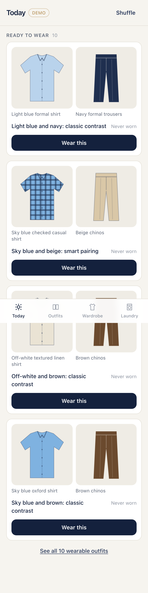
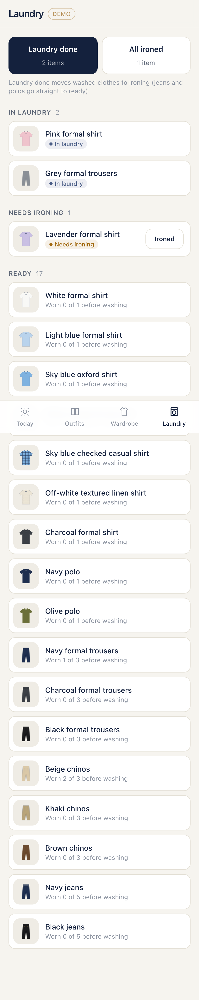

# Wardrobe Planner

Photograph your office clothes once. AI pairs them into outfits you approve, and each morning the app shows only the outfits whose every piece is washed and ironed. Picking what to wear becomes one tap.

> Status: demo mode complete and tested (phases 1–3). Real accounts, AI photo tagging and the live deploy come next.

<p>
  
  
  
</p>

## Try it locally

```bash
npm install
npm run dev          # http://localhost:3000 → "Try the demo"
```

Demo mode runs entirely in the browser on a sample 20-item wardrobe. It needs no accounts, keys or network.

## How pairing works

Pairing is a hybrid: deterministic rules do the bulk of the work, and an LLM is used only where judgement matters.

1. **Hard filters** drop pairs that never work: a formality gap above 2, two busy patterns, same-colour outfits (until you approve one), and anything you rejected before.
2. **Scoring (0–100)**: colour harmony from a 253-pair palette table (40), formality match (25), pattern balance (15), and a taste signal learned from your approvals and rejections (20).
3. **LLM re-rank** (with an account): Claude re-orders the top 30 and writes a short reason for each. Demo mode uses template reasons instead.

The pairing engine and item state machine are pure TypeScript in `lib/`, so they run on the server and in the browser, and are fully unit-tested.

## The daily loop

Items move through `ready → in laundry → needs ironing → ready`. Wearing a shirt sends it to the laundry; trousers stay in rotation until their third wear. Two bulk buttons (**Laundry done**, **All ironed**) keep state current with about two taps a week.

## Scripts

| Command | Does |
| --- | --- |
| `npm run dev` | Development server |
| `npm run lint` | ESLint + TypeScript |
| `npm test` | Unit tests (Vitest) |
| `npm run test:e2e` | End-to-end tests on demo mode (Playwright) |
| `npm run seed` | Rebuild the demo wardrobe and its SVG garments |

## Stack

Next.js (App Router, TypeScript), Tailwind CSS, installable as a PWA. Supabase (auth, Postgres, storage) and the Claude API arrive in phase 4; hosting on Vercel.

## Licence

MIT
