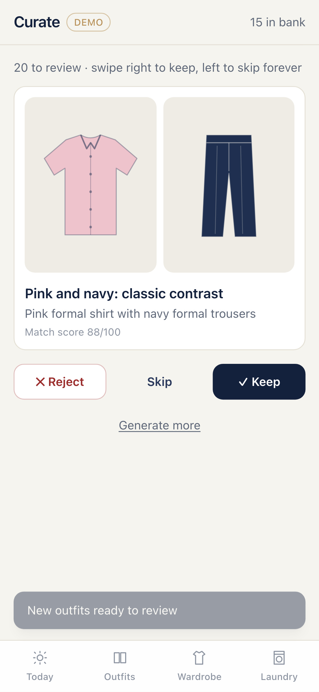
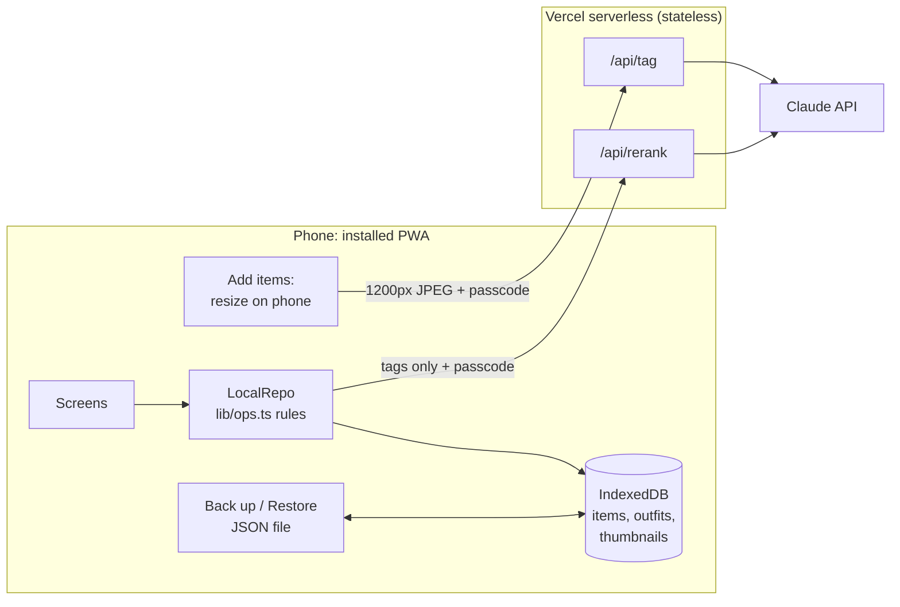

# Wardrobe Planner

Photograph your office clothes once. AI pairs them into outfits you approve, and each morning the app shows only the outfits whose every piece is washed and ironed. Picking what to wear becomes one tap.

> Status: demo and your own wardrobe with AI photo tagging are built. Everything is stored on your phone; nothing about your wardrobe is kept online.

<p>
  
  
  
</p>

## Try it locally

```bash
npm install
npm run dev          # http://localhost:3000 → "Try the demo"
```

Demo mode runs entirely in the browser on a sample 20-item wardrobe. It needs no accounts, keys or network.

To tag your own clothes with AI, follow [docs/SETUP.md](docs/SETUP.md): a Claude API key and a passcode in `.env.local` (or on Vercel). No accounts or database.

## How pairing works

Pairing is a hybrid: deterministic rules do the bulk of the work, and an LLM is used only where judgement matters.

1. **Hard filters** drop pairs that never work: a formality gap above 2, two busy patterns, same-colour outfits (until you approve one), and anything you rejected before.
2. **Scoring (0–100)**: colour harmony from a 253-pair palette table (40), formality match (25), pattern balance (15), and a taste signal learned from your approvals and rejections (20).
3. **LLM re-rank** (your wardrobe): Claude re-orders the top 30 and writes a short reason for each. Demo mode uses template reasons instead.

The pairing engine and item state machine are pure TypeScript in `lib/`, so they run on the server and in the browser, and are fully unit-tested.

## Architecture

Local-first: your wardrobe lives on your phone, and the server only runs the AI.



- **Private by design.** Photos are resized on the phone, sent once to be tagged, and never stored on a server. Only a small thumbnail is kept, on the phone. Re-ranking sends tags, never photos.
- **One set of rules.** Every change (wear, laundry, approve, edit) is a pure function over a snapshot in `lib/ops.ts`, shared by the demo and your wardrobe and unit-tested once.
- **AI where it earns its place.** Rules filter and score every pair (fast, free, testable); Claude tags photos and re-ranks only the top 30. Model replies are validated with zod against a fixed palette, and any AI failure falls back to rules.
- **Cost guarded.** The two AI endpoints need a passcode only the owner knows, compared in constant time, with a per-instance rate limit; the Anthropic spend limit is the hard cap.
- **No lock-in.** A backup file (thumbnails included) moves the wardrobe between phones. A cloud version with accounts and sync lives on the [`supabase-backend`](../../tree/supabase-backend) branch.

## The daily loop

Items move through `ready → in laundry → needs ironing → ready`. Wearing a shirt sends it to the laundry; trousers stay in rotation until their third wear. Two bulk buttons (**Laundry done**, **All ironed**) keep state current with about two taps a week.

## Scripts

| Command | Does |
| --- | --- |
| `npm run dev` | Development server |
| `npm run lint` | ESLint + TypeScript |
| `npm test` | Unit tests (Vitest) |
| `npm run test:e2e` | End-to-end tests on demo mode (Playwright) |
| `npm run seed` | Rebuild the demo wardrobe and its SVG garments |

## Stack

Next.js (App Router, TypeScript), Tailwind CSS, installable PWA with IndexedDB storage · Claude API (vision tagging, re-ranking) on Vercel serverless functions · zod · Vitest and Playwright.

## Licence

MIT
